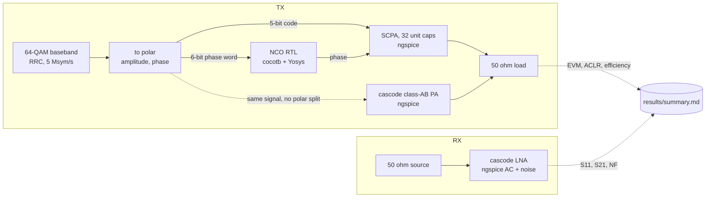
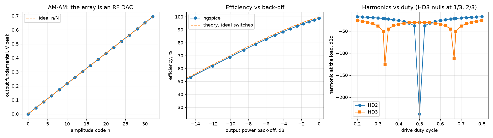
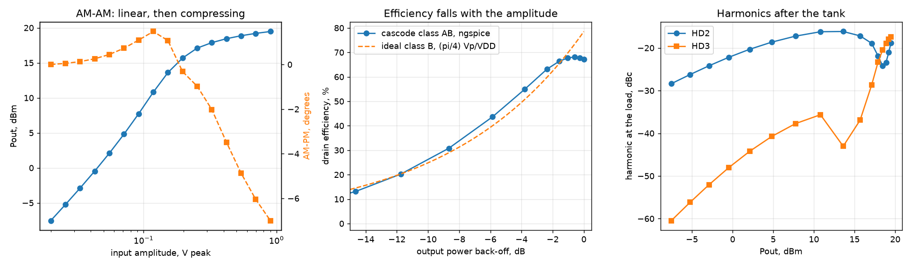
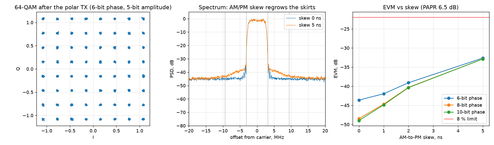
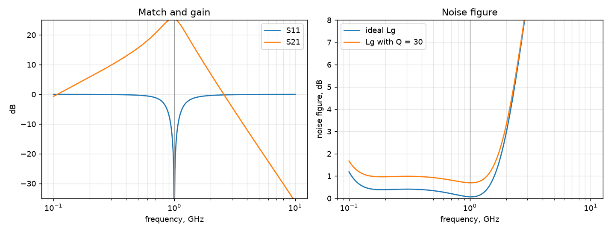

# ee: a 1 GHz CMOS transceiver testbench in Python and open-source EDA

A testbench for learning the Python + open-source circuit flow. My background is
analog/RF IC design in commercial tools (a 40 nm CMOS polar transmitter, published
at ESSERC 2024); this workflow was new to me. To learn it, I built one block from
each domain at 1 GHz, wired every tool to Python, and now move the blocks from
ideal parts to real ones, one rung at a time, with an AI coding agent (Claude)
writing most of the code while I set the specs, the checks and the physics:

| Domain | Block | Tool driven from Python | Rung |
|---|---|---|---|
| Analog / RF | switched-capacitor PA (SCPA): the polar AM path | ngspice (`.tran`) | 0, ideal switches |
| Analog / RF | cascode class-AB PA: the linear reference | ngspice (`.tran`, `.ac`) | 1, generic CMOS |
| Digital | NCO with phase modulation: the polar PM path | Icarus Verilog + cocotb, Yosys | RTL + generic gates |
| System | polar 64-QAM transmitter from the AM and PM paths | numpy, scipy, pandas | behavioural |
| RF receive | inductively degenerated cascode LNA | ngspice (`.op`, `.ac`, `.noise`) | 1, generic CMOS |

One command runs everything and checks each block against a spec. Every check can
fail, and two are made to fail on purpose (see "Checks that can fail"). OPEN marks
a spec the design does not meet yet and that is the next rung of work.

```bash
python3 run_all.py      # about 25 s; writes results/ and results/summary.md
```



## Results

Headline for the transmitter, at a 64-QAM signal's 6.5 dB back-off: average
efficiency 83.3 % for the SCPA (rung 0: ideal switches, no driver power) against
59.0 % for the cascode class-AB PA, whose EVM of 10.7 % also needs digital
predistortion (OPEN). Polar path: ACLR -39.5 dBc, EVM 0.66 % with a 6-bit phase
word. Receiver: NF 0.70 dB, S21 25.4 dB, S11 under -10 dB from 0.94 to 1.07 GHz.

From `results/summary.md` (ngspice 42, Icarus 12.0, Yosys 0.33, cocotb 2.1, Python 3.13):

| Block | Check | Result | Spec | |
|---|---|---|---|---|
| TX AM | Pout at full code | 4.81 mW | >= 4.5 | PASS |
| TX AM | efficiency vs SCPA theory, worst gap | 1.1 pts | <= 3 | PASS |
| TX AM | HD3 at 1/3 duty | -126.0 dBc | <= -40 | PASS |
| TX AM | HD2 at 1/2 duty | -237.9 dBc | <= -40 | PASS |
| TX PM | cocotb tests on RTL | 3/3  | all pass | PASS |
| TX PM | mutant RTL caught by phase test | True  | True | PASS |
| TX PM | Yosys synthesis, generic gates | 176 cells | > 0 | PASS |
| TX PA | saturated output power | 19.5 dBm | >= 17 | PASS |
| TX PA | peak drain efficiency | 68.1 % | >= 50 | PASS |
| TX PA | drain efficiency at 6 dB back-off | 43.0 % | report | PASS |
| TX PA | AM-PM at saturation | -7.0 deg | report | PASS |
| TX PA | worst device Vds peak (1.2 V devices) | 4.19 V | <= 2.4 | OPEN |
| TX system | EVM, 64-QAM, 6-bit phase | 0.66 % | <= 8 | PASS |
| TX system | ACLR, 64-QAM, 6-bit phase | -39.5 dBc | <= -30 | PASS |
| TX system | 5 ns AM/PM skew degrades EVM | +11.0 dB | > 0 | PASS |
| TX system | SCPA average efficiency, 6.5 dB PAPR | 83.3 % | report | PASS |
| TX system | class-AB PA average efficiency, same | 59.0 % | report | PASS |
| TX system | class-AB PA EVM at P1dB peaks, no DPD | 10.7 % | <= 8 | OPEN |
| RX LNA | S11 at 1 GHz | -46.0 dB | <= -10 | PASS |
| RX LNA | S21 at 1 GHz | 25.4 dB | >= 15 | PASS |
| RX LNA | noise figure at 1 GHz (Lg Q = 30) | 0.70 dB | <= 2 | PASS |
| RX LNA | cascode removed: match breaks (Miller) | -2.0 dB | > -10 | PASS |

### TX AM: switched-capacitor PA (`tx_am_scpa/scpa.py`)



32 unit capacitors, each switched between VDD and ground or held at ground, drive a
series-resonant 50 ohm load at 1 GHz. The number of switching caps is the amplitude
code, so the array is an RF DAC (left). The efficiency at back-off follows the
textbook SCPA expression `eta = 4nQ / (4nQ + pi(N - n))` within 1.1 points; the gap
is the switches' on-resistance (middle). Sweeping the drive duty cycle shows the
harmonic nulls the theory predicts: HD3 at 1/3 and 2/3, HD2 at 1/2 (right).

### TX linear reference: cascode class-AB PA (`tx_pa_cascode/pa.py`)



Two stacked 100 nm NMOS devices on a 2.4 V supply, a drain tank tuned at 1 GHz by a
small-signal AC run, and a 16-point drive sweep in transient. Peak drain efficiency
is 68 %, and at 6 dB back-off it falls to 43 %, following the class-B law
(pi/4) * Vp/VDD (middle). Through the same 64-QAM signal with its peaks at the
1 dB compression point, its AM-AM and AM-PM give 10.7 % EVM: the job digital
predistortion does on silicon. The cascode's gate is held at a fixed 1.6 V, so the
top device takes most of the swing (4.2 V peak against 1.5 V on the bottom one);
letting that gate swing so the stack shares the voltage is the next rung.

### TX PM: NCO in Verilog (`tx_pm_nco/`)

A 24-bit phase accumulator with a 6-bit phase-modulation input (64 phase steps of
5.625 degrees). Three cocotb tests compare the RTL cycle by cycle with a Python
model; Yosys maps it to 176 generic gates (`results/nco_synth.v`).

### TX system: polar 64-QAM (`tx_system/polar_tx.py`)



The baseband is split into amplitude (quantized to the SCPA's codes, with the AM-AM
and AM-PM curves ngspice produced) and phase (quantized to the NCO's word). EVM is
0.66 % with a 6-bit phase. Delaying the AM path against the PM path by 5 ns raises
EVM by 11 dB and regrows the spectral skirts (middle): the timing alignment every
polar transmitter needs at bring-up.

### RX: cascode LNA (`rx_lna/lna.py`)



Inductive source degeneration makes the input look like 50 ohm without a resistor:
Re{Zin} = omega_T * Ls. The flow is the one a designer follows by hand, with the
simulator closing each loop: the bias point from an ngspice `.op` (Newton steps on
Vgs for 5 mA), the input capacitance from a one-point `.ac` (the `.op` printout's
Cgg leaves out overlap and fringe capacitance, about 80 % more), a hand calculation
for Ls and Lg, then a six-step loop that nulls Im{Zin}, sets Re{Zin} to 50 ohm and
centres the drain tank. The hand values land about 20 % (Lg) and 35 % (Ls) away from
the tuned ones. With the same inductors and the cascode removed, Miller multiplication
of the gate-drain capacitance moves S11 from -46 dB to -2 dB.

## What this is not (read before trusting a number)

- **The SCPA is at rung 0.** Ideal voltage-controlled switches (0.5 ohm on at full
  code), a lossless inductor and no switch drivers. Its ~99 % peak and 83 % average
  efficiency leave out driver, clock and inductor loss; silicon lands far lower. The
  harmonic nulls at -126 and -238 dBc are numerical floors of a perfectly symmetric
  simulation; mismatch sets the real floor.
- **The CMOS blocks use a generic BSIM4 card** (`common/models.py`), not a foundry
  model: typical oxide, threshold, mobility and overlap values for a 1.2 V,
  100 nm-class process. Breakdown, gate resistance and induced gate noise are not
  modelled, so the LNA's 0.70 dB NF is optimistic (almost all of it is the gate
  inductor's loss) and the PA's 4.2 V device stress shows up only as a check.
- **The NCO is the digital phase word, not an oscillator.** A real PM path turns this
  word into phase with a DPLL or a digital-to-time converter; that block is not here.
- **The polar model is behavioural.** Amplitude and phase are quantized and the PAs'
  simulated AM-AM/AM-PM is applied, but the PM path has no bandwidth limit and there
  is no noise.

## Ladder

| Rung | What changes | Status |
|---|---|---|
| 0 | ideal switches and sources, lossless passives | SCPA |
| ½ | linear small-signal (hybrid-pi) models in place of each transistor | LNA, next |
| 1 | generic BSIM4 transistors, finite-Q inductors | LNA, cascode PA |
| 1 | SCPA unit cells as CMOS inverters with their drivers | next |
| 1 | cascode gate swinging with the drain, so the stack shares the voltage | next (OPEN) |
| 1 | memoryless DPD for the class-AB PA | next (OPEN) |
| 0 to 1 | LC-tank DCO and a PLL around the NCO | planned |
| 2 | foundry PDK (IHP SG13G2 via IIC-OSIC-TOOLS), corners | planned |
| 3 | layout and extracted parasitics | planned |

## Checks that can fail

`run_nco.py` also builds the RTL with `-DMUTANT`, a deliberate bug (the phase input is
ignored), and `run_all.py` only passes if the phase-modulation test catches it. The
LNA is also simulated with its cascode removed and the same inductors, and the run
only passes if the match breaks there.

These are the agent's mistakes the checks caught while building this, kept here
because catching them was the point of the exercise:

1. **Wrong capacitor formula.** The first SCPA used `C = Q / (w0 R)` instead of
   `1 / (w0 R Q)`; the output power check failed.
2. **A source that hides the loss.** Driving the caps from ramped pulse sources showed
   about 98 % efficiency at every code: charging a cap from a ramp is nearly lossless,
   so the CV^2 f switching loss vanished. The theory comparison flagged it; switches
   to a DC rail fixed it, and the simulation then matched theory within 1.1 points.
3. **cocotb timing.** Inputs were written during the read-only phase and a second clock
   was started on every reset; fixed by starting one clock per test and driving inputs
   after a falling edge.
4. **LNA match.** In a first BJT version S11 was -7 dB: without a cascode, Miller
   multiplies the base-collector capacitance. A cascode fixed it, and the check that
   removes the cascode keeps that lesson in the run.
5. **The wrong capacitance.** The CMOS LNA's first hand design used ngspice's `Cgg`
   from the operating point and put Lg at 82 nH against a tuned 37 nH. `Cgg` there is
   the intrinsic part only; a one-point AC run that measures the whole gate
   capacitance brought the hand value to about 20 % of it.

## Run it

On Ubuntu 24.04, natively or in WSL 2 on Windows. The GitHub Actions workflow in
`.github/workflows/checks.yml` runs the same steps on every push.

```bash
sudo apt install -y ngspice iverilog yosys python3-venv git
git clone https://github.com/h-aris/ee && cd ee
python3 -m venv .venv && . .venv/bin/activate
pip install -r requirements.txt
python3 run_all.py
```

Each block also runs alone, for example `python3 rx_lna/lna.py`.

- **Explore results like MATLAB:** open `explore.py` in VS Code (Remote WSL, Python
  extension) and run its `# %%` cells one at a time with Shift+Enter.
- **Open a simulation in interactive ngspice:** the final LNA and PA decks are kept in
  `results/decks/`. `cd results/decks/pa_full_drive && ngspice deck.cir` runs it,
  then `plot v(d) v(x)` shows how the two stacked devices share the drain swing;
  for the LNA (`lna_q30`), `setplot ac1` then `plot db(v(out))`.
- **Waveforms of the RTL tests:** `gtkwave tx_pm_nco/sim_build/rtl/nco.fst`
  (`sudo apt install gtkwave`).

## Layout

```
common/spice.py        ngspice batch runner and harmonic (Fourier) helper
tx_am_scpa/scpa.py     SCPA netlist generator, sweeps, plots
tx_pm_nco/rtl/nco.v    NCO RTL (with the MUTANT variant)
tx_pm_nco/test_nco.py  cocotb tests and Python reference model
tx_pm_nco/run_nco.py   cocotb runner (Icarus), mutant run, Yosys synthesis
tx_system/polar_tx.py  polar 64-QAM: EVM, ACLR, skew sweep, average efficiency
tx_pa_cascode/pa.py    cascode class-AB PA: tank tuning, drive sweep, back-off
rx_lna/lna.py          LNA bias, design, tuning loop, AC and noise, Miller check
common/models.py       the generic BSIM4 transistor cards
explore.py             "# %%" cells for poking at results with pandas
run_all.py             runs everything, prints PASS/FAIL, writes results/summary.md
drill/                 hand-analysis drill: ngspice, numpy, cocotb, Yosys.
```

## Next

The ladder above, from the top: CMOS SCPA cells, the swinging cascode gate, DPD,
then the IHP SG13G2 PDK through the IIC-OSIC-TOOLS image, and a DCO with a DPLL
for the phase path.
